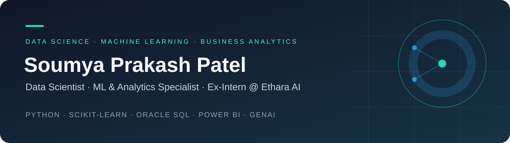

# Soumya Prakash Patel
### Data Scientist · Machine Learning & Analytics Specialist
**Computer Science Graduate · Ex-LLM Intern @ Ethara AI · IIM Sirmaur Certified**

---

## Executive Summary

Computer Science graduate with hands-on internship experience in **LLM post-training evaluation and prompt engineering at Ethara AI**. Proficient in **Python, Machine Learning (Scikit-Learn), SQL, Excel, and Power BI** (Power Query, DAX, dimensional modeling). 

Passionate about building production-grade predictive ML workflows and transforming complex business data into intuitive, decision-ready analytics that protect revenue and accelerate customer conversion.

* **Location:** Bengaluru, Karnataka, India
* **Education:** B.Sc. in Computer Science — Gangadhar Meher University (**CGPA: 7.69/10**)
* **Executive Certification:** Essentials of Data Analytics, GenAI & Execution — **IIM Sirmaur & Masai School**
* **Target Roles:** Data Analyst | Business Intelligence Analyst | Junior Data Scientist | Machine Learning Engineer

---

## Experience

### LLM Post Training Intern — **Ethara AI** *(Jan 2026 – May 2026)*
* Evaluated AI-generated responses and performed systematic quality assessments to support Large Language Model (LLM) post-training workflows.
* Authored and benchmarked targeted prompts for AI response generation, preference tuning, and automated evaluation tasks.
* Contributed to structured dataset curation, annotation, and data preparation pipelines across production AI initiatives.

---

## Technical Stack

| Category | Tools & Frameworks |
| :--- | :--- |
| **Machine Learning & AI** |    |
| **Data Science & Python** |      |
| **Database & SQL** |    |
| **Business Intelligence** |    |
| **Dev Tools & Workflow** |     |

---

## Featured Projects

### [Hotel Booking Cancellation Analysis Dashboard](https://github.com/somya-gif/Hotel-Booking-Cancellaton-Analysis)
> **Stack:** Power BI, SQL, DAX, Data Modeling, Business Intelligence.
* **Scope:** Analyzed **36,285 historical reservations** to evaluate **€4.30M in cancellation revenue loss** across a €11.35M portfolio.
* **Findings:** Identified lead time as the #1 driver of cancellations (8.9% up to 73.9% for >180 days) and proved that repeat guests cancel only 1.7% of the time.
* **SQL & BI Deliverable:** Designed an end-to-end analytics workflow combining a multi-dialect SQL query suite (`hotel_analysis.sql`) with a 4-page interactive executive Power BI dashboard.
* **[Explore Repository]**(https://github.com/somya-gif/Hotel-Booking-Cancellaton-Analysis) • `[Power BI Dashboard (.pbix)]` • `[SQL Queries]` • `[DAX Formulations]`

---

### [E-commerce Customer Repeat-Purchase Prediction System](https://github.com/somya-gif/ecommerce-customer-repurchase-ml)
> **Stack:** Python, Scikit-learn (Logistic Regression, Random Forest, Decision Tree), Pandas, Streamlit, Automated Testing.
* **Scope:** Analyzed ~1 million orders across 2 years from the UCI Online Retail II dataset to predict 30-day repeat purchases.
* **Methodology:** Designed temporal RFM feature engineering with strict date cutoffs to eliminate future data leakage, validated with automated regression tests (`test_features.py`).
* **Performance:** Achieved **3.14x Lift** in the top decile, **0.791 ROC-AUC**, and **53.0% Precision** on 4 months of completely unseen future test data.
* **Web Application:** Built an interactive Streamlit web dashboard for live customer scoring and exportable campaign lists.
* **[Explore Repository]**(https://github.com/somya-gif/ecommerce-customer-repurchase-ml) • `[Interactive Streamlit App]` • `[ML Pipeline]` • `[Unit Tests]`

---

## Education & Certifications

* **Bachelor of Science in Computer Science** — Gangadhar Meher University *(2023 – 2026 | CGPA: 7.69/10)*
* **Certificate Programme in Essentials of Data Analytics, GenAI & Execution** — **IIM Sirmaur**, in collaboration with Masai School *(2025 – 2026)*
* **Generative AI Mega Workshop** — NxtWave *(Nov 2024)*

---

## Contacts & Links

* **LinkedIn:** [linkedin.com/in/soumya-prakash-patel-49abb6366](https://www.linkedin.com/in/soumya-prakash-patel-49abb6366/)
* **Email:** [somya8407@gmail.com](mailto:somya8407@gmail.com)
* **Phone:** +91 8249247920
* **GitHub:** [github.com/somya-gif](https://github.com/somya-gif)
