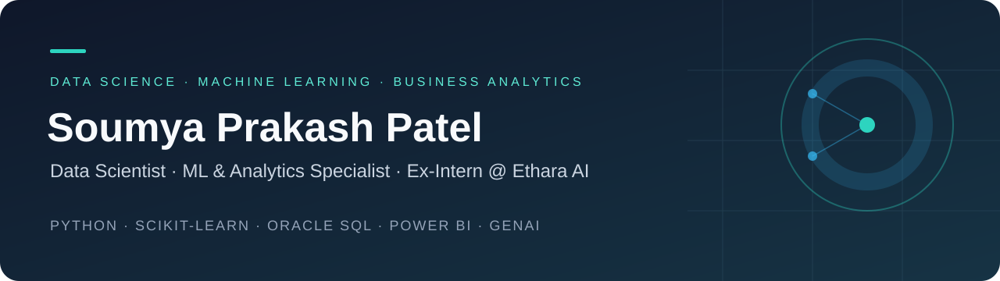

# Soumya Prakash Patel
### Aspiring Data Analyst · Business Analytics Enthusiast

**Interested in turning data into clear insights that support business decisions.**

---

## 👋 About Me

I am a **B.Sc. Computer Science graduate from Gangadhar Meher University**, having completed my degree in **May 2026**. I completed a **Data Analytics certification from IIM Sirmaur in October 2026**.

My skills include **Python, SQL, Excel and Power BI**, with a focus on data cleaning, data visualization and analytical thinking. I am seeking **entry-level Data Analyst and Business Analyst opportunities**.

## 🧰 Technical Toolkit

  
  
  
  

| Area | Skills |
|:--|:--|
| **Programming & querying** | Python, SQL |
| **Analysis & reporting** | Excel, Power BI |
| **Data preparation** | Data cleaning |
| **Communication through data** | Data visualization, analytical thinking |

## 📊 Portfolio

**Project showcase coming soon.**

Project files and case studies will be added as they are ready to share, with their business questions, datasets, analysis steps and findings.

[Browse available repositories →](https://github.com/somya-gif?tab=repositories)

## 🎓 Education & Certification

| Qualification | Institution | Completed |
|:--|:--|:--|
| **B.Sc. Computer Science** | Gangadhar Meher University | May 2026 |
| **Data Analytics Certification** | IIM Sirmaur | October 2026 |

## 🎯 Areas of Interest

- Cleaning and exploring data to understand patterns
- Using SQL and Python for analysis
- Presenting findings through Excel and Power BI
- Connecting analytical findings to business questions

## 🤝 Let's Connect

Open to **entry-level Data Analyst and Business Analyst roles**, learning opportunities and analytics collaboration.

**[LinkedIn](https://www.linkedin.com/in/soumya-prakash-patel-49abb6366/)** · **[Email](mailto:Somya8407@gmail.com)** · **[GitHub](https://github.com/somya-gif)**

---

Clear questions. Thoughtful analysis. Understandable insights.

